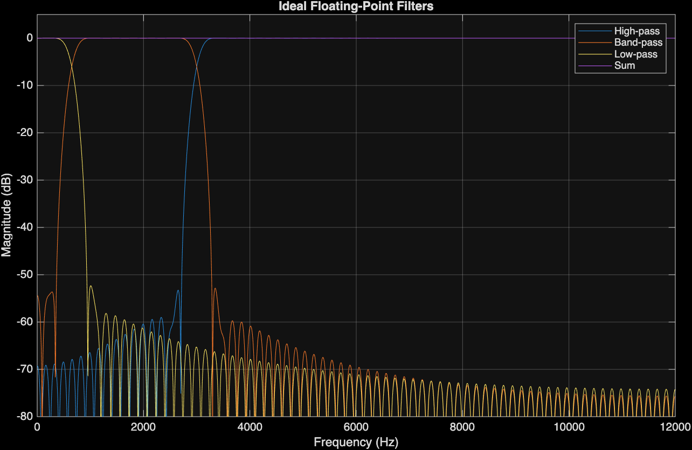
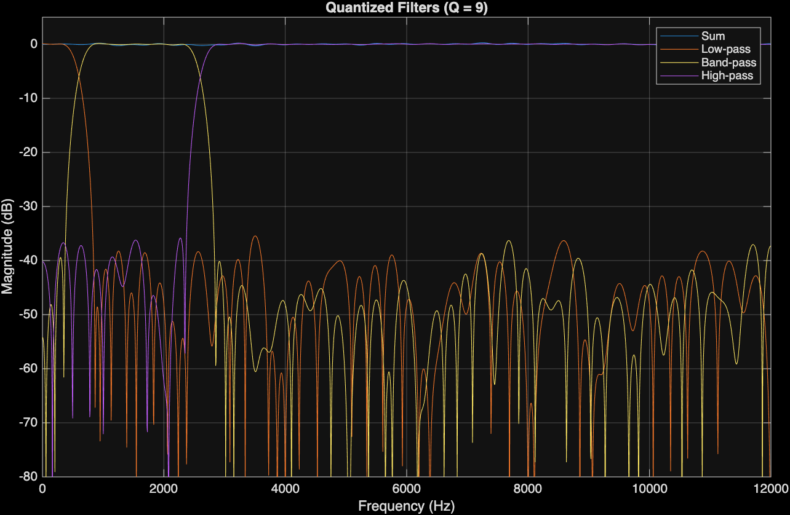
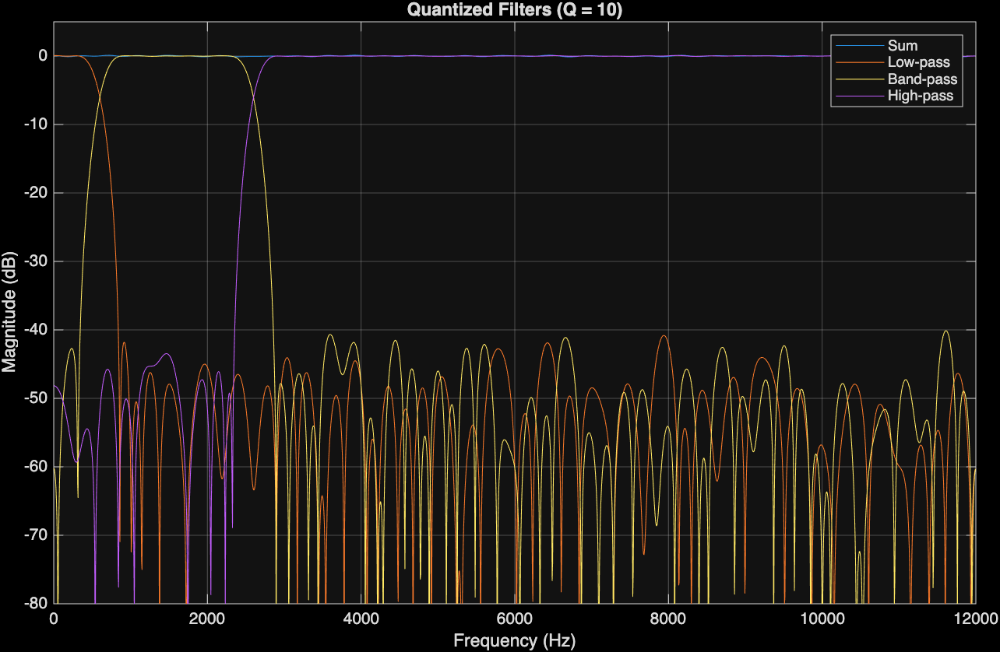
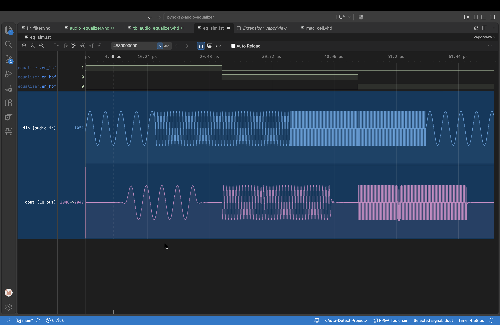

# PYNQ-Z2 3-Band FIR Audio Equalizer

A learning-focused FPGA audio equalizer project targeting the TUL PYNQ-Z2. It implements a real-time, three-band low-pass, band-pass, and high-pass equalizer core in VHDL with fixed-point FIR filters.

The repository includes MATLAB coefficient generation, the systolic FIR datapath and three-band equalizer core, single-clock audio peripherals, top-level board integration, and PYNQ-Z2 pin/timing constraints. Vivado implementation reports and live hardware verification are pending.

## Project Overview

The target system samples audio at 24 kHz, filters it through three parallel linear-phase FIR bands, and recombines the bands. The filter coefficients are designed in MATLAB and exported as a VHDL package. The implemented RTL includes a parameterized systolic FIR chain, a three-band equalizer core, SPI audio interfaces, and top-level board integration. Vivado implementation and live hardware verification are not yet complete.

## Hardware Platform

| Item | Specification |
| --- | --- |
| FPGA board | TUL PYNQ-Z2 |
| FPGA device | AMD/Xilinx Zynq-7000, `xc7z020clg400-1` |
| System clock | 125 MHz, single clock domain |
| Microphone / ADC | Digilent PmodMIC, TI ADCS7476 12-bit SPI ADC |
| DAC | Digilent PmodDA2, TI DAC121S101 12-bit SPI DAC |
| Headphone amplifier | Digilent PmodAMP2 via PmodBB |

## System Architecture & Hardware Controls

The top-level uses one 125 MHz clock domain. `timing_gen` produces staggered, one-cycle enables for ADC capture (`en_adc`), DSP (`en_dsp`), and DAC transfer (`en_dac`) at a nominal 24 kHz cadence, plus the 2 Hz `led_blink` status signal. The XDC defines the clock on H16 with an 8.00 ns period.

Three `btn_controller` instances debounce BTN1–BTN3 for 20 ms and toggle the LPF, BPF, and HPF enable states. Each band defaults to `'1'` after reset. The ADC and DAC use single-domain SPI controllers with `HALF_DIV = 30`, giving a 2.083 MHz serial clock from 125 MHz. The ADC controller synchronizes MISO through two stages.

| Board control | Top-level signal | FPGA pin | Function |
| --- | --- | --- | --- |
| `SW0` | `sw_audio` | M20 | Audio enable; off forces DAC mid-scale `0x800` |
| `SW1` | `sw_eq` | M19 | Select equalizer (`1`) or bypass (`0`) |
| `BTN0` | `reset` | D19 | Synchronous active-high reset |
| `BTN1` | `btn_lpf` | D20 | Toggle LPF enable |
| `BTN2` | `btn_bpf` | L20 | Toggle BPF enable |
| `BTN3` | `btn_hpf` | L19 | Toggle HPF enable |
| `LD0` | `led_audio` | R14 | Off when muted; blink in EQ mode; solid in bypass |
| `LD1` | `led_lpf` | P14 | LPF active when audio and EQ mode are enabled |
| `LD2` | `led_bpf` | N16 | BPF active when audio and EQ mode are enabled |
| `LD3` | `led_hpf` | M14 | HPF active when audio and EQ mode are enabled |

| Pmod | Peripheral signal | Top-level signal | FPGA pin |
| --- | --- | --- | --- |
| PmodA (PmodMIC) | ADC chip select | `adc_cs` | Y18 |
| PmodA (PmodMIC) | ADC MISO | `spi_miso_adc` | Y16 |
| PmodA (PmodMIC) | ADC serial clock | `spi_sck_adc` | Y17 |
| PmodB (PmodDA2) | DAC chip select / sync | `dac_cs` | W14 |
| PmodB (PmodDA2) | DAC MOSI | `spi_mosi_dac_A` | Y14 |
| PmodB (PmodDA2) | DAC serial clock | `spi_sck_dac` | T10 |

## DSP Filter Specifications

| Parameter | Value |
| --- | --- |
| Sampling rate (`Fs`) | 24,000 Hz |
| Nyquist frequency | 12,000 Hz |
| LPF / BPF crossover (`fc1`) | 650 Hz |
| BPF / HPF crossover (`fc2`) | 3,000 Hz |
| Bands | LPF: 0–650 Hz; BPF: 650–3,000 Hz; HPF: 3,000–12,000 Hz |
| FIR length | `N = 141` taps (`M = 140` order) |
| Window and scaling | Hamming window; MATLAB `fir1` with `'noscale'` |
| Coefficient quantization | `Q = 12` fractional bits; scale factor `2^12 = 4096` |
| Coefficient integer range | −921 to +3072 in the generated package |
| Data width | `DATA_WIDTH = 12` bits, signed within the FIR datapath |
| Coefficient width | `COEF_WIDTH = 13` bits, signed |
| Product width | `PROD_WIDTH = 25` bits (`12 + 13`) |
| Accumulator width | `SUM_WIDTH = 33` bits (`25 + 8` guard bits) |
| Mixing width | `MIX_WIDTH = 35` bits (`33`-bit band outputs plus 2 guard bits) |
| Group delay | 70 samples for each linear-phase filter |

The three filters are designed so their floating-point responses sum to approximately 0 dB. The MATLAB script also plots the floating-point and quantized responses for visual inspection.

## Systolic Array FIR Architecture

`fir_filter` builds a parameterized chain of 141 `mac_cell` instances using a VHDL `for ... generate` loop. Each cell multiplies its input sample by a coefficient, adds the product to the incoming sum, and passes delayed sample data to the next cell. The cell registers two data-delay stages and one sum stage, with synchronous active-high reset and clock enable. Coefficients are supplied through the `COEFFS` generic, defaulting to `COEF_LPF` from the generated `eq_coeffs_pkg` package.

The FIR output is a 33-bit signed accumulated result.

## 3-Band Equalizer Core

`audio_equalizer` converts the 12-bit unsigned offset-binary input to signed two's-complement by inverting its MSB, then feeds the sample to three parallel `fir_filter` instances configured with the LPF, BPF, and HPF coefficient arrays. It conditionally sums enabled band outputs in a 35-bit signed value, performs an arithmetic `shift_right` by `Q = 12`, and saturates the result to the signed 12-bit range `[-2048, +2047]`. The output is converted back to offset-binary by inverting the MSB. The core and its testbench are present and verified in simulation.

## Repository Structure

```text
.
├── .github/
│   └── copilot-instructions.md
├── docs/
│   ├── Ideal.png
│   ├── Q9.png
│   ├── Q10.png
│   ├── Q12.png
│   └── sim_equalizer_vaporview.png
├── fpga/
│   ├── rtl/
│   │   ├── eq_coeffs_pkg.vhd      # Generated coefficient package
│   │   ├── mac_cell.vhd           # FIR multiply-accumulate cell
│   │   ├── fir_filter.vhd         # Parameterized FIR chain
│   │   ├── audio_equalizer.vhd    # 3-band mixing, scaling, and saturation
│   │   ├── timing_gen.vhd         # Clock-enable and LED timing
│   │   ├── btn_controller.vhd    # Debounced band toggles
│   │   ├── adc_controller.vhd     # PmodMIC SPI ADC interface
│   │   ├── dac_controller.vhd     # PmodDA2 SPI DAC interface
│   │   └── top_audio_eq.vhd      # Board-level RTL integration
│   ├── sim/
│   │   └── tb_audio_equalizer.vhd
│   └── constraints/
│       └── pynq_z2.xdc            # Clock and PYNQ-Z2 pin assignments
├── matlab/
│   ├── design_eq_filters.m      # Filter design, plots, and VHDL export
│   └── design_eq_filters.asv    # MATLAB autosave file
└── README.md
```

### Filter Response and Simulation Plots

MATLAB floating-point and fixed-point response plots:






Equalizer simulation waveform:



## How to Run

### Generate the coefficient package with MATLAB

Run this from the repository root. The script requires MATLAB functions `fir1` and `freqz` (Signal Processing Toolbox) and writes the generated package to `fpga/rtl/eq_coeffs_pkg.vhd`.

```sh
matlab -batch "cd('matlab'); run('design_eq_filters.m')"
```

### Analyze and elaborate the complete top level with NVC

Run from the repository root:

```sh
nvc -a fpga/rtl/eq_coeffs_pkg.vhd fpga/rtl/mac_cell.vhd fpga/rtl/fir_filter.vhd fpga/rtl/audio_equalizer.vhd fpga/rtl/timing_gen.vhd fpga/rtl/btn_controller.vhd fpga/rtl/adc_controller.vhd fpga/rtl/dac_controller.vhd fpga/rtl/top_audio_eq.vhd && nvc -e top_audio_eq
```

### Run the equalizer simulation

The testbench exercises the LPF, BPF, and HPF paths with passband and stopband tones. Analyze the testbench along with the RTL, then elaborate and run it with a waveform output:

```sh
nvc -a fpga/rtl/eq_coeffs_pkg.vhd fpga/rtl/mac_cell.vhd fpga/rtl/fir_filter.vhd fpga/rtl/audio_equalizer.vhd fpga/sim/tb_audio_equalizer.vhd
nvc -e tb_audio_equalizer
nvc -r tb_audio_equalizer --wave=eq_sim.fst
```

## Roadmap / Implementation Status

- [x] MATLAB design script for three 141-tap FIR bands and VHDL coefficient export.
- [x] Generated coefficient package with LPF, BPF, and HPF coefficient arrays.
- [x] Parameterized systolic FIR RTL (`mac_cell` and `fir_filter`); project notes record NVC verification.
- [x] Three-band equalizer core (`audio_equalizer.vhd`) and simulation testbench (`tb_audio_equalizer.vhd`), verified with NVC.
- [x] Stage 5: 125 MHz timing, debounced buttons, SPI ADC, and SPI DAC (`timing_gen.vhd`, `btn_controller.vhd`, `adc_controller.vhd`, `dac_controller.vhd`).
- [x] Stage 6 RTL/constraints integration (`top_audio_eq.vhd`, `fpga/constraints/pynq_z2.xdc`), analyzed and elaborated with NVC.
- [ ] Vivado synthesis and implementation, resource/timing reports, and live hardware verification on the PYNQ-Z2.

## Vivado Implementation & Hardware Verification

**Pending / TBD.** Populate this section after running Vivado with LUT, FF, and DSP48E1 utilization, plus 125 MHz WNS/WHS timing results. Live PYNQ-Z2 verification is also pending.