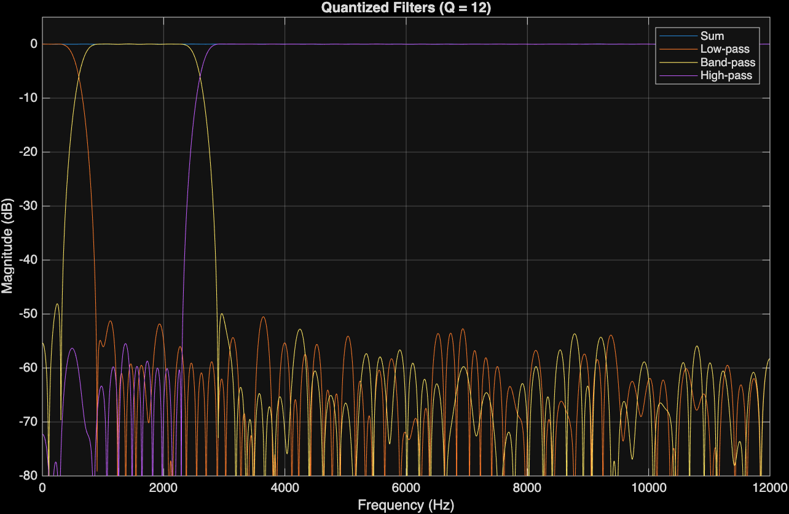

# PYNQ-Z2 3-Band FIR Audio Equalizer

A learning-focused FPGA audio equalizer project targeting the TUL PYNQ-Z2. It implements a real-time, three-band low-pass, band-pass, and high-pass equalizer core in VHDL with fixed-point FIR filters.

The repository includes MATLAB coefficient generation, a VHDL coefficient package and systolic FIR datapath, and a simulated three-band equalizer core. Audio peripherals, board-level integration, and hardware verification remain planned.

## Project Overview

The target system samples audio at 24 kHz, filters it through three parallel linear-phase FIR bands, and recombines the bands. The filter coefficients are designed in MATLAB and exported as a VHDL package. The implemented RTL includes a parameterized systolic FIR chain and a three-band equalizer core. Audio I/O and board-level integration are not yet implemented.

## Hardware Platform & Controls

| Item | Specification |
| --- | --- |
| FPGA board | TUL PYNQ-Z2 |
| FPGA device | AMD/Xilinx Zynq-7000, `xc7z020clg400-1` |
| Planned system clock | 125 MHz, single clock domain |
| Microphone / ADC | Digilent PmodMIC, TI ADCS7476 12-bit SPI ADC |
| DAC | Digilent PmodDA2, TI DAC121S101 12-bit SPI DAC |
| Headphone amplifier | Digilent PmodAMP2 via PmodBB |

The controls below describe the intended board interface. They are **planned**; no top-level design or board constraints currently implement them.

| Control | Planned function |
| --- | --- |
| `SW0` | Audio master enable; output is muted to mid-scale (`0x800`) when off |
| `SW1` | Mode select: bypass (`0`) or three-band equalizer (`1`) |
| `BTN0` | Synchronous active-high reset; reset band state is all on (`111`) |
| `BTN1` / `BTN2` / `BTN3` | Debounced LPF / BPF / HPF toggle buttons |
| `LD0` | Audio status: off when muted, solid in bypass, blinking in equalizer mode |
| `LD1` / `LD2` / `LD3` | LPF / BPF / HPF active indicators |

## DSP Filter Specifications

| Parameter | Value |
| --- | --- |
| Sampling rate (`Fs`) | 24,000 Hz |
| Nyquist frequency | 12,000 Hz |
| LPF / BPF crossover (`fc1`) | 650 Hz |
| BPF / HPF crossover (`fc2`) | 3,000 Hz |
| Bands | LPF: 0–650 Hz; BPF: 650–3,000 Hz; HPF: 3,000–12,000 Hz |
| FIR length | `N = 141` taps (`M = 140` order) |
| Window and scaling | Hamming window; MATLAB `fir1` with `'noscale'` |
| Coefficient quantization | `Q = 12` fractional bits; scale factor `2^12 = 4096` |
| Coefficient integer range | −921 to +3072 in the generated package |
| Data width | `DATA_WIDTH = 12` bits, signed within the FIR datapath |
| Coefficient width | `COEF_WIDTH = 13` bits, signed |
| Product width | `PROD_WIDTH = 25` bits (`12 + 13`) |
| Accumulator width | `SUM_WIDTH = 33` bits (`25 + 8` guard bits) |
| Mixing width | `MIX_WIDTH = 35` bits (`33`-bit band outputs plus 2 guard bits) |
| Group delay | 70 samples for each linear-phase filter |

The three filters are designed so their floating-point responses sum to approximately 0 dB. The MATLAB script also plots the floating-point and quantized responses for visual inspection.

## Systolic Array FIR Architecture

`fir_filter` builds a parameterized chain of 141 `mac_cell` instances using a VHDL `for ... generate` loop. Each cell multiplies its input sample by a coefficient, adds the product to the incoming sum, and passes delayed sample data to the next cell. The cell registers two data-delay stages and one sum stage, with synchronous active-high reset and clock enable. Coefficients are supplied through the `COEFFS` generic, defaulting to `COEF_LPF` from the generated `eq_coeffs_pkg` package.

The FIR output is a 33-bit signed accumulated result.

## 3-Band Equalizer Core

`audio_equalizer` converts the 12-bit unsigned offset-binary input to signed two's-complement by inverting its MSB, then feeds the sample to three parallel `fir_filter` instances configured with the LPF, BPF, and HPF coefficient arrays. It conditionally sums enabled band outputs in a 35-bit signed value, performs an arithmetic `shift_right` by `Q = 12`, and saturates the result to the signed 12-bit range `[-2048, +2047]`. The output is converted back to offset-binary by inverting the MSB. The core and its testbench are present and verified in simulation.

## Repository Structure

```text
.
├── .github/
│   └── copilot-instructions.md
├── docs/
│   ├── Ideal.png
│   ├── Q9.png
│   ├── Q10.png
│   ├── Q12.png
│   └── sim_equalizer_vaporview.png
├── fpga/
│   ├── rtl/
│   │   ├── eq_coeffs_pkg.vhd      # Generated coefficient package
│   │   ├── mac_cell.vhd           # FIR multiply-accumulate cell
│   │   ├── fir_filter.vhd         # Parameterized FIR chain
│   │   └── audio_equalizer.vhd    # 3-band mixing, scaling, and saturation
│   └── sim/
│       └── tb_audio_equalizer.vhd
├── matlab/
│   ├── design_eq_filters.m      # Filter design, plots, and VHDL export
│   └── design_eq_filters.asv    # MATLAB autosave file
└── README.md
```

### Filter Response and Simulation Plots

MATLAB floating-point and fixed-point response plots:




Equalizer simulation waveform:


## How to Run

### Generate the coefficient package with MATLAB

Run this from the repository root. The script requires MATLAB functions `fir1` and `freqz` (Signal Processing Toolbox) and writes the generated package to `fpga/rtl/eq_coeffs_pkg.vhd`.

```sh
matlab -batch "cd('matlab'); run('design_eq_filters.m')"
```

### Compile and simulate with NVC

Run from the repository root. Analyze the package and RTL in dependency order, elaborate the testbench, and run it while writing the waveform to `eq_sim.fst`:

```sh
nvc --std=2008 -a \
  fpga/rtl/eq_coeffs_pkg.vhd \
  fpga/rtl/mac_cell.vhd \
  fpga/rtl/fir_filter.vhd \
  fpga/rtl/audio_equalizer.vhd \
  fpga/sim/tb_audio_equalizer.vhd
nvc -e tb_audio_equalizer
nvc -r tb_audio_equalizer --wave=eq_sim.fst
```

This testbench exercises the LPF, BPF, and HPF paths with passband and stopband tones. The equalizer core is simulated; the complete top-level board design is not yet available.

## Roadmap / Implementation Status

- [x] MATLAB design script for three 141-tap FIR bands and VHDL coefficient export.
- [x] Generated coefficient package with LPF, BPF, and HPF coefficient arrays.
- [x] Parameterized systolic FIR RTL (`mac_cell` and `fir_filter`); project notes record NVC verification.
- [x] Three-band equalizer core (`audio_equalizer.vhd`) and simulation testbench (`tb_audio_equalizer.vhd`), verified with NVC.
- [ ] Single-clock timing and peripheral controllers: sample-rate enable, button debounce, SPI ADC, and SPI DAC.
- [ ] Top-level board integration, PYNQ-Z2 constraints, and Vivado build.
- [ ] Full-system simulation and hardware verification after board-level integration.